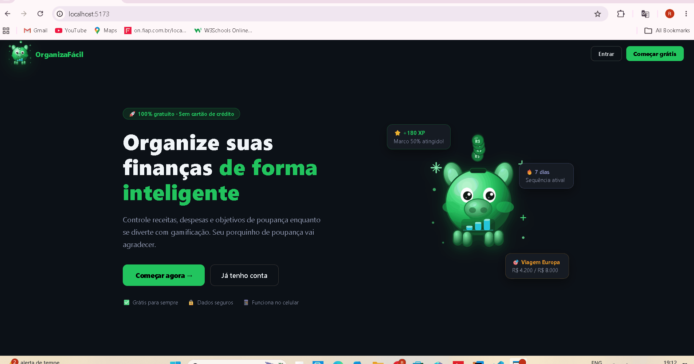
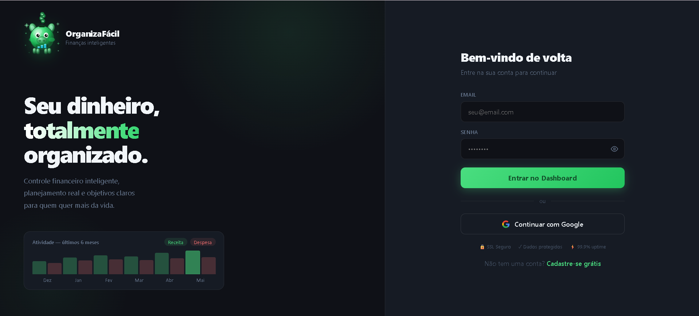
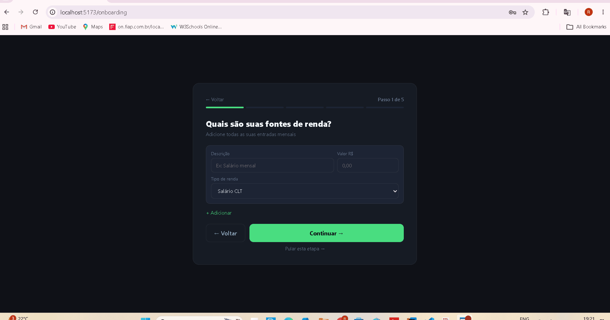
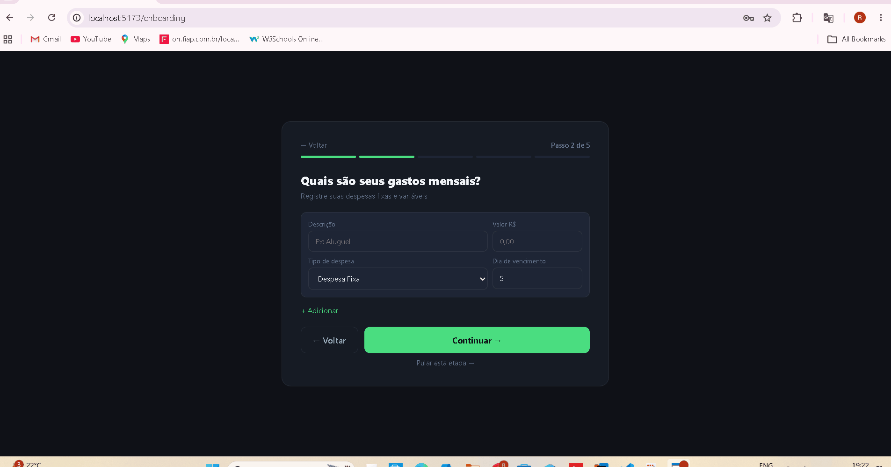
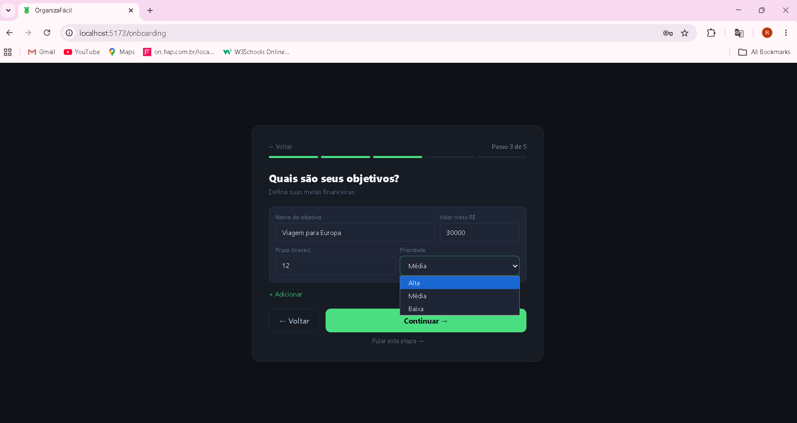
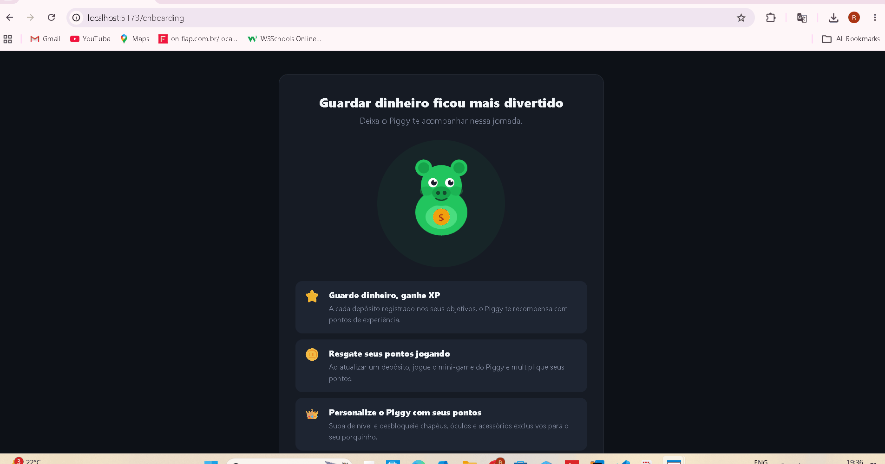
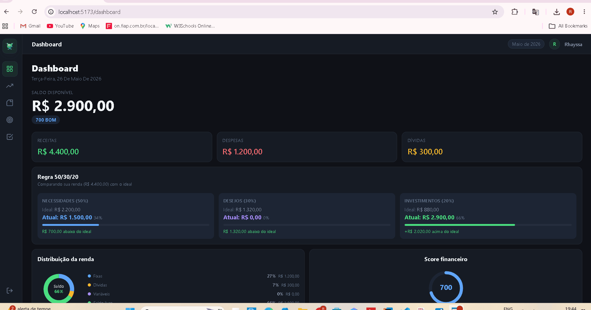
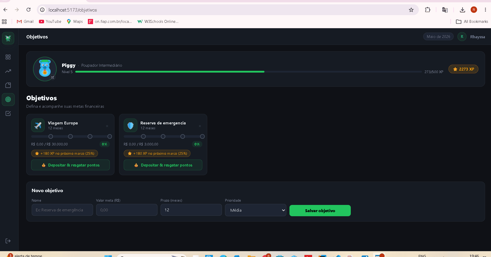
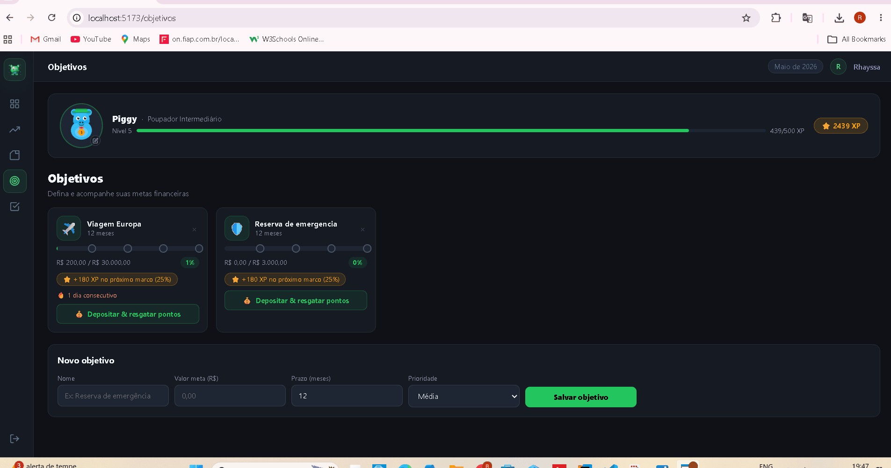
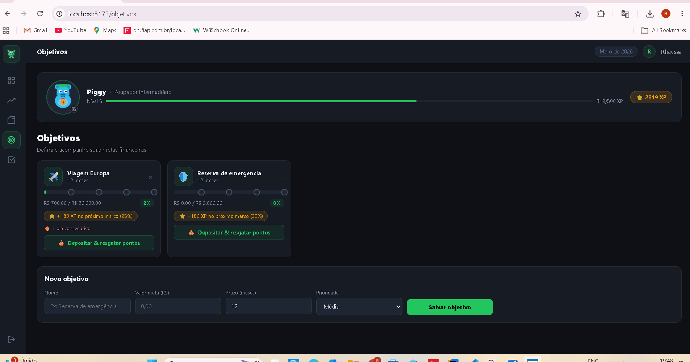

# 🐷 OrganizaFácil — Finanças Inteligentes

Plataforma de controle financeiro pessoal com gamificação.
Gerencie receitas, despesas e objetivos de poupança
enquanto evolui seu avatar e ganha pontos de experiência.

---

## 🚀 Demonstração

### Landing Page


### Login


### Onboarding — Receitas


### Onboarding — Gastos


### Onboarding — Objetivos


### Onboarding — Gamificação


### Dashboard


### Mini-game — Pegar Moedas


### Mini-game — Corrida do Piggy


### Personalização do Avatar


### Objetivos com Gamificação


---

## 🛠️ Tecnologias

### Backend
- Java 17
- Spring Boot
- Spring Data JPA
- Oracle Database (FIAP)
- Maven

### Frontend
- React 18
- TypeScript
- Vite
- React Router DOM
- Axios
- Google OAuth

---

## 📋 Pré-requisitos

- Java 17+
- Node.js 18+
- npm 9+
- IntelliJ IDEA (recomendado para o backend)

---

## ▶️ Como rodar o projeto

### Backend

```bash
# 1. Abra a pasta do backend no IntelliJ IDEA

# 2. Configure o banco de dados Oracle
# Edite src/main/resources/application.properties:
spring.datasource.url=jdbc:oracle:thin:@...
spring.datasource.username=SEU_USUARIO
spring.datasource.password=SUA_SENHA

# 3. Rode a aplicação
# Clique em Run no IntelliJ ou execute:
./mvnw spring-boot:run

# O backend sobe em:
# http://localhost:8080
```

### Frontend

```bash
# 1. Entre na pasta do frontend
cd organizafacil-frontend

# 2. Instale as dependências
npm install

# 3. Rode o projeto
npm run dev

# O frontend abre em:
# http://localhost:5173
```

---

## 👤 Como usar

1. Acesse http://localhost:5173
2. Clique em **Começar grátis** ou **Criar conta**
3. Preencha nome, email e senha
4. Siga o onboarding de 5 passos:
   - Cadastre suas fontes de renda
   - Registre suas despesas
   - Defina seus objetivos financeiros
   - Veja seu plano de ação personalizado
   - Configure lembretes de vencimento
5. Acesse o dashboard e comece a usar!

---

## 🎮 Funcionalidades

### Controle Financeiro
- 📊 Dashboard com saldo, receitas, despesas e score financeiro
- 💰 Gestão de receitas por categoria
- 💸 Controle de despesas fixas, variáveis e dívidas
- 🎯 Objetivos de poupança com metas e prazos
- 📋 Plano de ação personalizado baseado nos dados financeiros
- 📅 Exportação de lembretes de vencimento (.ics)
- 📈 Regra 50/30/20 calculada automaticamente

### Gamificação
- ⭐ Sistema de XP — ganhe pontos a cada depósito
- 🏆 Marcos de conquista em 25%, 50%, 75% e 100%
- 🔥 Streak de dias consecutivos
- 🎮 Mini-games após cada depósito:
  - **Pegar Moedas** — clique nas moedas antes do tempo acabar
  - **Corrida do Piggy** — pule os obstáculos e sobreviva
- 🐷 Avatar personalizável com chapéus, óculos e acessórios
- 🎉 Celebração ao completar objetivos

---

## 🗂️ Estrutura do Projeto

### Frontend
```
organizafacil-frontend/
├── src/
│   ├── components/
│   │   ├── despesas/       # componentes de despesa
│   │   ├── form/           # campos de formulário
│   │   ├── gamification/   # avatar, jogos, objetivos
│   │   ├── landing/        # seções da landing page
│   │   └── ui/             # componentes genéricos
│   ├── context/            # AuthContext
│   ├── hooks/              # hooks customizados
│   ├── pages/              # páginas da aplicação
│   ├── services/           # chamadas à API
│   ├── styles/             # CSS global e variáveis
│   ├── types/              # interfaces TypeScript
│   └── utils/              # funções utilitárias
├── screenshots/            # imagens do README
└── README.md
```

---

## 🔗 Endpoints principais da API

| Método | Endpoint | Descrição |
|--------|----------|-----------|
| POST | `/api/usuarios` | Criar usuário |
| POST | `/api/usuarios/login` | Login |
| GET | `/api/receitas/usuario/{id}` | Listar receitas |
| POST | `/api/receitas` | Criar receita |
| PUT | `/api/receitas/{id}` | Atualizar receita |
| DELETE | `/api/receitas/{id}` | Excluir receita |
| GET | `/api/despesas/usuario/{id}` | Listar despesas |
| POST | `/api/despesas` | Criar despesa |
| PUT | `/api/despesas/{id}` | Atualizar despesa |
| DELETE | `/api/despesas/{id}` | Excluir despesa |
| GET | `/api/objetivos/usuario/{id}` | Listar objetivos |
| POST | `/api/objetivos` | Criar objetivo |
| PUT | `/api/objetivos/{id}` | Atualizar objetivo |
| DELETE | `/api/objetivos/{id}` | Excluir objetivo |
| GET | `/api/dashboard/{id}` | Dados do dashboard |

---

## 📄 Licença

Projeto acadêmico desenvolvido para a FIAP.
